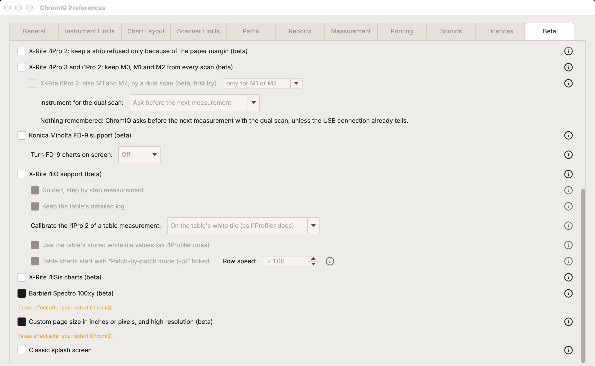
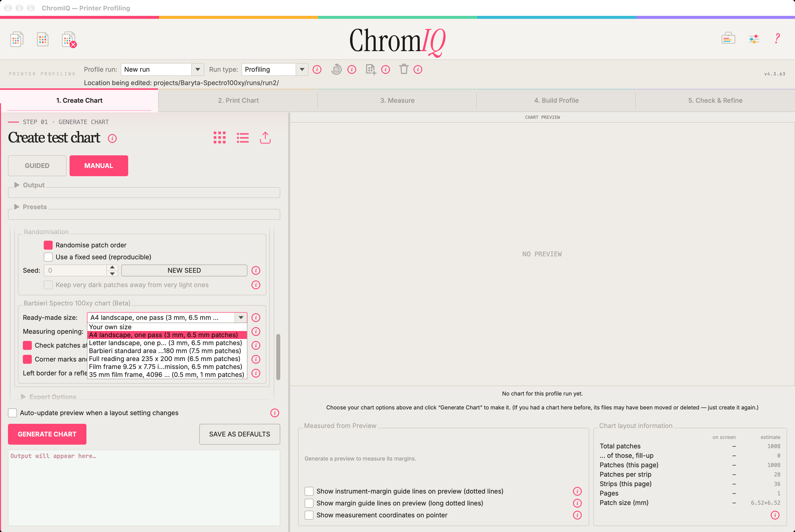
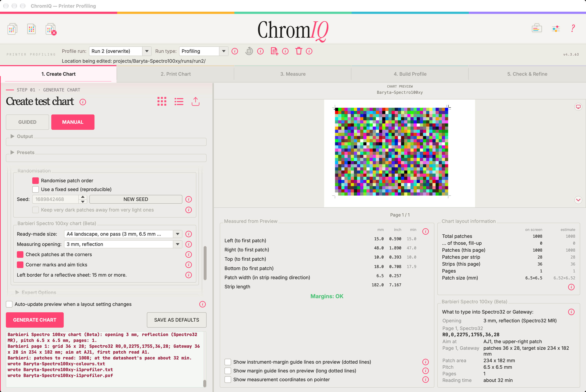
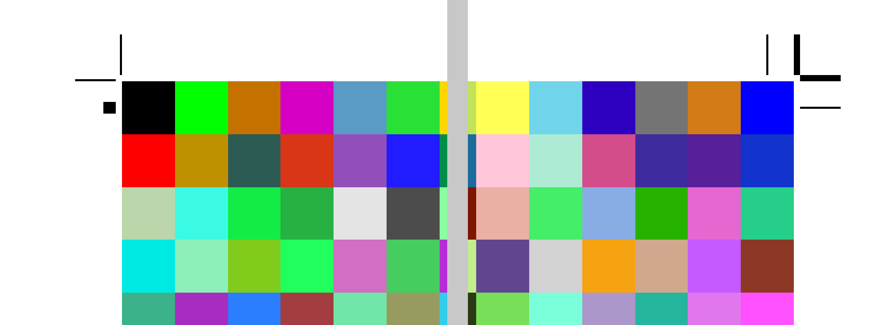
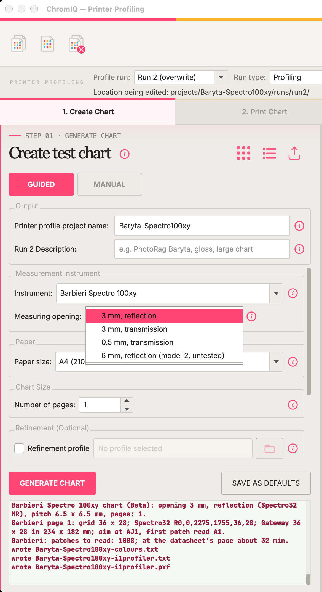
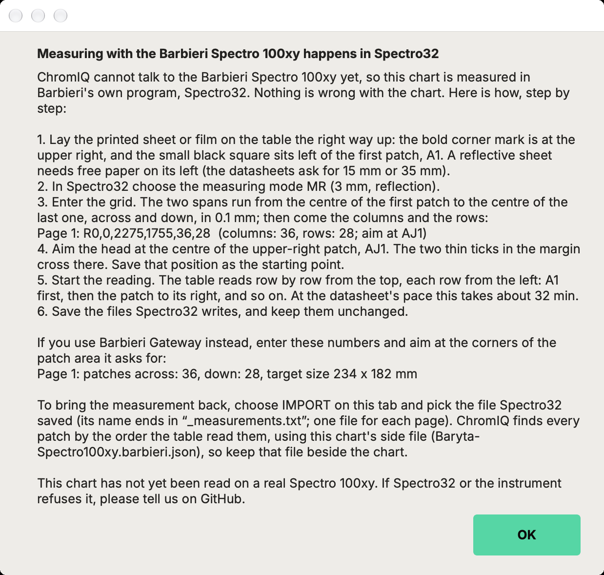
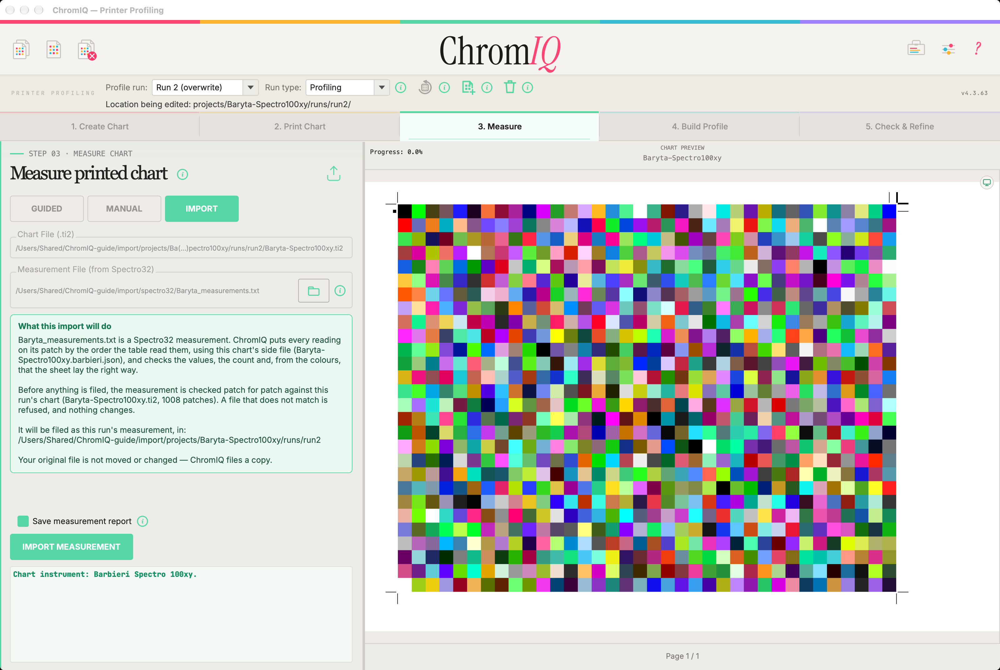
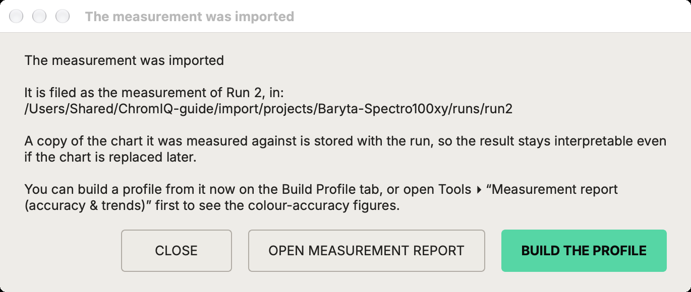

# Charts for the Barbieri Spectro 100xy (beta), step by step

ChromIQ has a beta option for the **Barbieri Spectro 100xy**, a measuring table
that reads a chart patch by patch at fixed positions, for reflective prints
and for film. It was asked for by a Spectro 100xy owner in
[issue 215](https://github.com/itsab1989/ChromIQ/issues/215).

ChromIQ makes the chart and tells you the numbers to type into Barbieri's
program. The measuring itself happens in Barbieri's own program, Spectro32
(or Gateway). Since ChromIQ 4.3.63 you can then bring Spectro32's measurement
files back into ChromIQ and build the profile there.

This page shows, with pictures from the real app, what the beta can do and how
to use it. Every label, number and picture below was checked in **ChromIQ
4.3.63** on a Mac, in English, with the light appearance.

- [1. Honest limits first](#1-honest-limits-first)
- [2. Switching it on](#2-switching-it-on)
- [3. Making a chart in MANUAL](#3-making-a-chart-in-manual)
- [4. What is printed on the chart](#4-what-is-printed-on-the-chart)
- [5. The numbers for Spectro32 and Gateway](#5-the-numbers-for-spectro32-and-gateway)
- [6. A 35 mm film frame](#6-a-35-mm-film-frame)
- [7. Making a chart in GUIDED](#7-making-a-chart-in-guided)
- [8. Measuring in Spectro32](#8-measuring-in-spectro32)
- [9. Bringing the measurement back (IMPORT)](#9-bringing-the-measurement-back-import)
- [10. What we would like to hear from you](#10-what-we-would-like-to-hear-from-you)

---

## 1. Honest limits first

- **No ChromIQ chart has been read on a real Spectro 100xy yet.** Nobody on the
  ChromIQ team owns one. The layout follows Barbieri's datasheets, the way
  Barbieri's programs describe a chart, and one owner's real measurement
  files. If you try it, you are the first, so please tell us what you find
  ([section 10](#10-what-we-would-like-to-hear-from-you)).
- **The import was tested with made-up files** in the shape of one owner's real
  reflective run (the pictures in section 9 use such a file). It has not yet
  seen a real transmission file or a chart of several pages.
- **Not there yet:** importing Gateway's files, averaging several imports of
  one chart, and writing a Spectro32 template file for you. ChromIQ does not
  talk to the instrument itself either.
- **The 0.5 mm transmission and the 6 mm reflection openings are untested**
  even on paper; the 3 mm openings follow the owner's real run.
- **With the option off, nothing changes.** ChromIQ works exactly as before.

---

## 2. Switching it on

1. Open the preferences: the sliders icon at the top right of the ChromIQ
   window. The window is called "ChromIQ Preferences".
2. Click the **Beta** tab.
3. Tick **"Barbieri Spectro 100xy (beta)"**. A window explains what the beta
   does and asks whether you want to switch it on. **"Keep it off"** is the
   default; click **"Turn it on"**.
4. If you want to make film frames in pixels (section 6), also tick
   **"Custom page size in inches or pixels, and high resolution (beta)"**.
5. The orange line under each says "Takes effect after you restart ChromIQ."
   Click **OK**, quit ChromIQ and start it again.

You can switch it off again the same way at any time.

---

## 3. Making a chart in MANUAL

After the restart, go to **"1. Create Chart"** and click **MANUAL**. Give the
project a name under "Printer profile project name:" (the pictures use
"Baryta-Spectro100xy"). Under "ChromIQ layout", choose **"Barbieri Spectro
100xy"** as the **Instrument:**.

A group of its own appears further down the panel, called **"Barbieri Spectro
100xy chart (Beta)"**. (In the pictures, "Output" and "Presets" are folded away
with their small triangles to make room. You can do the same.)

- **"Ready-made size:"** fills in the paper, margins and patch size for you.
  The choices are:
  - "A4 landscape, one pass (3 mm, 6.5 mm patches)": 36 x 28 = 1008 patches
  - "Letter landscape, one pass (3 mm, 6.5 mm patches)": 36 x 30
  - "Barbieri standard area 225 x 180 mm (7.5 mm patches)": 30 x 24
  - "Full reading area 235 x 200 mm (6.5 mm patches)": 36 x 30
  - "Film frame 9.25 x 7.75 in (3 mm transmission, 6.5 mm patches)": 34 x 28
    at 2032 ppi
  - "35 mm film frame, 4096 x 2730 px at 2731 ppi (0.5 mm, 1 mm patches)":
    36 x 23

  The list is narrow, so some names are shortened in the middle with "..."
  in it; the full names are the ones above. Every value a size fills in stays
  editable. Once you change one, the choice shows "Your own size".
- **"Measuring opening:"** the opening you read with: "3 mm, reflection",
  "3 mm, transmission", "0.5 mm, transmission" or "6 mm, reflection (model 2,
  untested)". It sets the patch size the chart starts from.
- **"Check patches at the corners"** and **"Corner marks and aim ticks"**,
  both ticked by default (section 4 shows what they print).
- The note **"Left border for a reflective sheet: 15 mm or more."** The table
  needs free paper on the left of the patches. Barbieri's datasheets say 15 mm
  in some places and 35 mm in others; new charts start with 15 mm, so widen
  the left margin if your table needs more.

A few layout options make no sense for this table and are greyed, each with
its reason in its (i): spacers, the patch scale, the layout mode, offset strips
and hexagons, among others. Everything else stays open.

Choose **"A4 landscape, one pass"** and click **GENERATE CHART**. A second or
two later the chart is in the preview, the numbers are beside it (section 5),
and the log under the button says the same in one block.

---

## 4. What is printed on the chart

Here is the top of the same A4 chart, enlarged straight from the chart file:
the left end of the first row on the left, the right end on the right.

- **Corner marks** at the four corners of the patch grid, in the margins,
  never on a patch. Their arms continue the grid's outer edges. The
  **upper-right one is bold**, so you can tell at a glance which way up the
  sheet lies. (Gateway aims at three of the corners.)
- **Two thin aim ticks**: one above the last column and one to the right of
  the first row. Lined up with your eye or the laser, they cross at the
  **centre of the upper-right patch**, which is where Spectro32 is aimed
  before it starts (AJ1 on this chart).
- **A small solid square left of A1**, the first patch the table reads.
- **Check patches**: a few of the chart's own patches are moved to fixed
  places on every page. The darkest sits at A1 (the black patch in the
  picture), the most colourful at the upper-right patch (the blue one), the
  lightest at the lower-left patch, and two clearly different colours right of
  and below A1. Only their places change; the set of colours and the number of
  patches stay the same. When you import the measurement, ChromIQ uses them to
  check that the sheet lay the right way round.

With narrow margins (film frames) the marks are drawn smaller, and a margin too
narrow for them leaves that side out; ChromIQ says so.

---

## 5. The numbers for Spectro32 and Gateway

Under "Chart layout information", the group **"Barbieri Spectro 100xy (Beta)"**
says **"What to type into Spectro32 or Gateway:"**. For the A4 chart:

- **Opening:** the measuring mode to choose in Spectro32 (here MR, 3 mm
  reflection).
- **Spectro32:** the grid line **R0,0,2275,1755,36,28**. The two spans run from
  the centre of the first patch to the centre of the last, across and down, in
  0.1 mm (227.5 mm and 175.5 mm); then come the columns and the rows. The two
  offsets are 0, because you set the start by hand.
- **Aim at:** the patch where the aim ticks cross, AJ1.
- **Gateway:** the patches across and down, and the target size (patch count
  times pitch, in whole millimetres).
- **Patch area, Pitch, Pages** and the **Reading time** at the pace in
  Barbieri's datasheet (about 1.9 s a patch).

A chart of several pages has one Spectro32 line and one Gateway line per page.
Rows and columns above 99 (Gateway's limit) are reported.

---

## 6. A 35 mm film frame

The 35 mm ready-made size needs the second beta from section 2, "Custom page
size in inches or pixels, and high resolution (beta)". Without it, the two film
frames are greyed in the list and say why.

Choose **"35 mm film frame, 4096 x 2730 px at 2731 ppi (0.5 mm, 1 mm
patches)"** and click **GENERATE CHART**. The panel shows Paper "Custom…",
Units "Pixels (page size only)", Custom size 4096 x 2730 px and the line "The
page will be 4096 x 2730 pixels (11.2 megapixels) at 2731 pixels per inch,
which is 38.1 x 25.39 mm (1.4998 x 0.9996 in)." The opening is "0.5 mm,
transmission" (Spectro32 M5), with 1 mm patches and 1 mm margins.

The result is **828 patches, 36 x 23**, and the Spectro32 line
**R0,0,350,220,36,23**. The chart image is exactly 4096 x 2730 pixels and says
2731 pixels per inch inside the file.

For more about pixel-exact frames for a film recorder, see
[Charts for a film recorder](film_recorder_pages.md).

---

## 7. Making a chart in GUIDED

In **GUIDED**, choose **"Barbieri Spectro 100xy"** as the instrument. A
**"Measuring opening:"** choice appears beside it, with the same four openings
as in MANUAL.

The paper list follows the opening. For the 3 mm and 6 mm openings it offers
A4 and Letter, landscape first. For the 0.5 mm opening it offers only the two
film frames, which need the page-size beta. MANUAL keeps every paper for every
opening.

---

## 8. Measuring in Spectro32

Print the chart as you print any ChromIQ chart ("2. Print Chart"), or image a
film frame on your film recorder. Then go to
**"3. Measure"** and click **START MEASUREMENT**. ChromIQ cannot drive the
Spectro 100xy, so instead of measuring it opens a window that explains, step by
step and with your chart's own numbers, how to measure it in Spectro32:

In short:

1. Lay the sheet or film on the table the right way up: the bold corner mark
   at the upper right, the small black square left of A1.
2. In Spectro32 choose the measuring mode the window names (MR for 3 mm
   reflection).
3. Enter the grid line from the window, for example `R0,0,2275,1755,36,28`.
4. Aim the head at the centre of the upper-right patch, where the two thin
   ticks cross, and save that position as the starting point.
5. Start the reading. The table reads row by row from the top, each row from
   the left: A1 first, then the patch to its right, and so on.
6. Save the files Spectro32 writes, and keep them unchanged.

The steps describe only the marks that are really printed on your chart, so
they follow your choices for "Check patches at the corners" and "Corner marks
and aim ticks".

---

## 9. Bringing the measurement back (IMPORT)

This is new in **ChromIQ 4.3.63**.

1. In **"3. Measure"**, with the run that holds the Barbieri chart selected
   at the top, click **IMPORT**.
2. Under **"Measurement File (from Spectro32)"**, click the folder button and
   pick the file Spectro32 saved: its name ends in `_measurements.txt`
   (`_VAL.txt` and `_spectrum.txt` are taken too). A chart of several pages
   needs one file per page, all picked at once.
3. The green box **"What this import will do"** says what ChromIQ is about to
   do with that file and where it will file a copy. Your own file is never
   moved or changed.
4. Click **IMPORT MEASUREMENT**.

What ChromIQ does with it:

- **Every reading is put on its patch by the reading order**, using the
  chart's side file (`<name>.barbieri.json`, written beside the chart). Keep
  that file next to the chart.
- **It keeps the spectra** and works out the colour from them the way
  ArgyllCMS does, then compares that with the colour values Spectro32 wrote
  itself.
- **It checks how the sheet lay.** A sheet that was mirrored, upside down,
  turned, or aimed one patch off is refused, and the window says which. When
  ChromIQ cannot tell, it asks you; **Cancel** is the default, and if you
  answer Import, that answer is recorded in the filed measurement.
- **For film read by transmission**, Build Profile then preselects the Media
  Type "Transparent".

When it worked, a window says so and offers to build the profile straight
away:

(The file in these pictures is made up, in the shape of a real Spectro32 file.
That is how the import was tested; see section 1.)

The reading of Spectro32's files is adapted from the converter that a Spectro
100xy owner, LVTguru, shared with us under the GPL-3.0. Thank you.

---

## 10. What we would like to hear from you

If you try the beta with a real Spectro 100xy, anything you can tell us helps,
in [issue 215](https://github.com/itsab1989/ChromIQ/issues/215) or a new issue:

- **Did Spectro32 (or Gateway) accept the numbers**, and did the head land on
  the centre of the patches from the first to the last?
- **Were the marks easy to see** under the laser or on the light box, and did
  the aim ticks help you find the upper-right patch?
- **For a first real test of the import**, these files of one run: the chart's
  `.tif`, `.ti2` and `.barbieri.json`, the Spectro32 template you used, and
  the files Spectro32 wrote (`_measurements.txt`, `_VAL.txt`, and
  `_XYZ.txt` / `_LAB.txt` if it wrote them).
- **The app log**: in ChromIQ, the "?" at the top right opens the help window,
  and "Show the log file" is beside its Close button. It records the chart's grid
  numbers and every import step. Please look through it before you post it.
- **Screenshots or photos** of anything that went wrong: Spectro32's grid
  dialog, the sheet on the table, a ChromIQ window.

Thank you for trying it.
