# Charts for a film recorder: a page as exact pixels (beta)

ChromIQ 4.3.43 has a new beta option, **"Custom page size in inches or pixels,
and high resolution (beta)"**. It was asked for by a film recorder user in
[issue 215](https://github.com/itsab1989/ChromIQ/issues/215): a film recorder
images a picture of an exact number of pixels at an exact resolution, for
example 4096 x 2730 pixels at 2731 pixels per inch for a 35 mm frame, and it
reads that resolution from the file. If the resolution in the file is
different, the recorder scales the picture, and a scaled chart is no good for
profiling.

This page shows, step by step and with pictures from the real app, how to make
such a chart: first for the 35 mm frame, then for two larger frames, then with
your own choice of colours. Every label, number and picture below was checked
in ChromIQ 4.3.43 on a Mac, in English.

- [1. What the beta does, and its honest limits](#1-what-the-beta-does-and-its-honest-limits)
- [2. Switching it on](#2-switching-it-on)
- [3. A page as exact pixels](#3-a-page-as-exact-pixels)
- [4. Worked example: the 35 mm frame, 4096 x 2730 pixels at 2731 ppi](#4-worked-example-the-35-mm-frame-4096-x-2730-pixels-at-2731-ppi)
- [5. The two larger frames](#5-the-two-larger-frames)
- [6. How many patches fit on one frame](#6-how-many-patches-fit-on-one-frame)
- [7. Choosing your own colours with the patch set generator](#7-choosing-your-own-colours-with-the-patch-set-generator)
- [8. Measuring elsewhere and bringing the measurement back](#8-measuring-elsewhere-and-bringing-the-measurement-back)
- [9. What we would like to hear from you](#9-what-we-would-like-to-hear-from-you)

---

## 1. What the beta does, and its honest limits

With the option on, **"1. Create Chart"** in **MANUAL** offers:

- **A custom page size in millimetres (now with fractions, such as 234.95), in
  inches, or as an exact number of pixels.** There are three rows of fields,
  one per unit. The fields you type in are the ones that count; the other two
  rows show the same size converted, for information.
- **A line under the paper size that says how many pixels the page will have**,
  for every paper size.
- **A resolution of up to 6000 instead of 1200.**
- **"Resolution unit:"** under **Output**: the resolution can be written into
  the chart image in pixels per inch, as a whole number, instead of pixels per
  centimetre. A chart made at 2731 reads back as exactly 2731 pixels per inch.

The limits, so you know what you are trying:

- **Not yet tried with a real film recorder.** The files were checked on the
  computer only: the pixel count of every page, the resolution written in the
  file, and the bit depth and compression. If you image a chart made this way,
  we would very much like to hear how it came out (see
  [section 9](#9-what-we-would-like-to-hear-from-you)).
- **A memory limit.** Drawing a very large page needs a lot of memory, so
  ChromIQ works out beforehand what a chart would need and refuses one that
  would need more than about 8 GB, before it draws anything. That is about 570
  megapixels for a one-page 8 bit RGB chart. The largest frame below,
  18796 x 15748 pixels (296 megapixels), is made in RGB without trouble; the
  same page in CMYK would be refused. The limit is the same on every computer
  and applies only to what only this option allows.
- **Where it is offered.** Only in Create Chart, MANUAL, and only where the
  ChromIQ layout engine lays the chart out ("Use the ChromIQ layout engine
  instead of printtarg" ticked, which is the default). For the FD-9 (a beta of
  its own) the "Resolution unit:" box is greyed on "Pixels per centimetre",
  because the FD-9 layout always writes that. For the i1iO a custom page is
  turned upright, and a size typed in pixels turns with it and stays exact.
- **With the option off, nothing changes.** ChromIQ makes, measures and builds
  exactly as before, and your charts, measurements and profiles do not change.
  A chart made with the option and opened while it is off stays as it is;
  Create Chart says what its real page and resolution are, and does not make
  it again at another size until you switch the option back on.
- **Reading a frame by coordinates is not built yet.** A chart made for a
  reader that measures by position (a mark at the first patch and the grid
  numbers that Spectro32 asks for) is a separate step and still being
  discussed. The settings below leave all labels off so that the grid is
  clean.

---

## 2. Switching it on

1. Open the preferences: the sliders icon at the top right of the ChromIQ
   window. The window is called "ChromIQ Preferences".
2. Click the **Beta** tab.
3. Tick **"Custom page size in inches or pixels, and high resolution (beta)"**.
   The orange line under it says "Takes effect after you restart ChromIQ."
4. Click **OK**, quit ChromIQ and start it again.

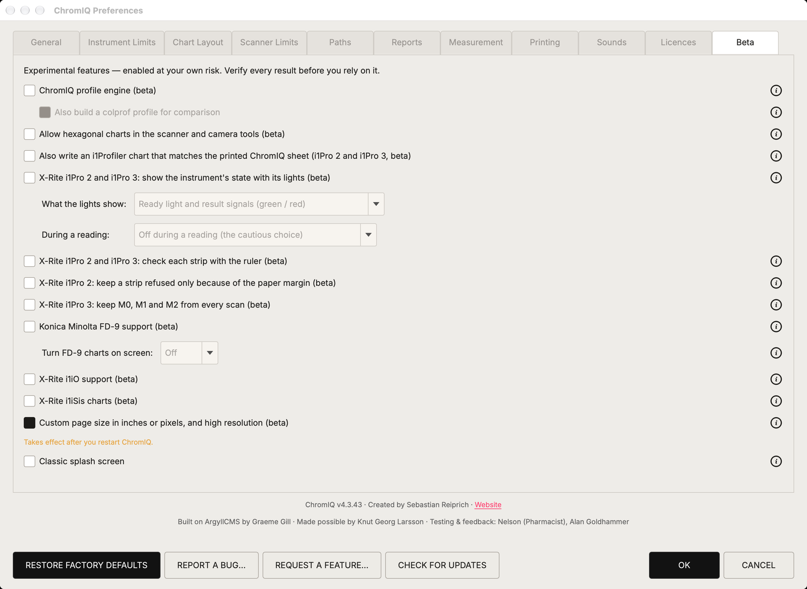

You can switch it off again the same way at any time.

---

## 3. A page as exact pixels

After the restart, go to **"1. Create Chart"** and click **MANUAL**. Give the
project a name under "Printer profile project name:" (the pictures use
"Film-35mm"). Under "ChromIQ layout", choose your **Instrument:** and set
**Paper:** to **"Custom…"**. Three rows of fields appear next to
**"Custom size:"**:

| Row | Unit | Example (35 mm frame) |
|---|---|---|
| first | mm | 38.10 x 25.39 |
| second | in | 1.4998 x 0.9996 |
| third | px | 4096 x 2730 |

**The row you type in is the one that counts.** If you type 4096 and 2730 in
the px row, the chart is exactly 4096 x 2730 pixels, whatever the millimetre
and inch rows show (they are only rounded for display). You can even mix: a
width in pixels and a height in inches is fine.

Pixels and resolution belong together. A size typed in pixels keeps its pixels
when you change the resolution, so the page gets larger or smaller on paper. A
size typed in millimetres or inches keeps its size, and its pixel count follows
the resolution. Either way, the grey line under the fields always tells you
the result, for example:

> The page will be 4096 x 2730 pixels (11.2 megapixels) at 2731 pixels per inch.

If a side typed in pixels would be longer than 2000 mm or shorter than 1 mm at
the resolution you have set, that line turns red, says so, and names the
resolutions that fit. "GENERATE CHART" then makes no chart until it fits.
Nothing is shortened or changed for you.

The other settings that matter for a film recorder:

- **"Resolution:"** under "Page geometry" (it shows "dpi" after the number) is
  the resolution of the chart image, up to 6000. It is taken when you press
  Return or leave the box, so typing 2032 never passes through 203 on the way.
  If you have read about a field called "TIFF Output DPI": that is the same
  setting for charts made by printtarg, and it is not shown when the ChromIQ
  layout engine makes the chart, which this option needs.
- **"Resolution unit:"** under "Expert Options", "Output": choose **"Pixels per
  inch"**. The default, "Pixels per centimetre", gives the same size on paper,
  but a recorder that expects pixels per inch could read it differently.
- **"Bit depth:"** **"8-bit"** and **"Compression:"** **"None"**, in the same
  "Output" group, give an 8 bit RGB file without compression.

---

## 4. Worked example: the 35 mm frame, 4096 x 2730 pixels at 2731 ppi

These are the settings for a plain grid of 1 x 1 mm patches with no labels, no
spacers and no text on the frame. Go through the panel from top to bottom.

**Step 1.** In "1. Create Chart", **MANUAL**:

- "Printer profile project name:" **Film-35mm** (or any name you like).
- Make sure **"Stamp settings down the right edge"** is unticked.
- Leave **"Use the ChromIQ layout engine instead of printtarg"** ticked.
- "Instrument:" **"SpectroScan (flatbed)"**. This is the layout you already
  used successfully; it reads patch by patch, so it has no gaps between
  patches.
- "Paper:" **"Custom…"**, "Pages:" 1.

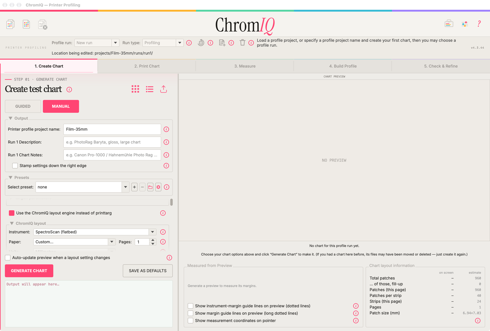

**Step 2.** Under "Page geometry", set **"Resolution:"** to **2731**. Then, in
the **px** row next to "Custom size:", type **4096** and **2730**. The order
does not matter. The line under the fields now says "The page will be
4096 x 2730 pixels (11.2 megapixels) at 2731 pixels per inch." (In the
picture, "Output" and "Presets" are folded away with their small triangles, to
make room. You can do the same.)

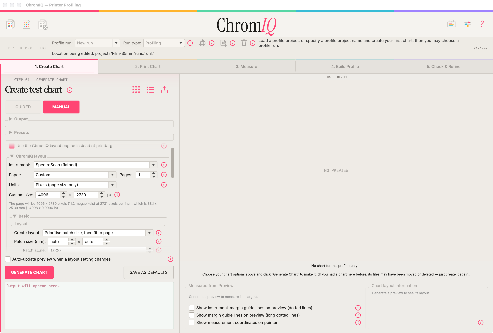

**Step 3.** Under "Basic", "Layout":

- "Create layout:" **"Prioritise patch size, then fit to page"** (already
  chosen for the SpectroScan).
- "Patch size (mm):" **1.0** x **1.0**.
- Untick **"Show strip indicators"** and **"Show row indicators"**.
- "Clip border:" choose the entry that starts with **"Off"**.

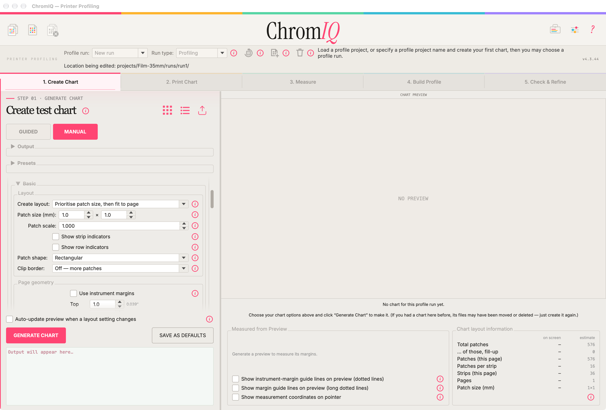

**Step 4.** Under "Page geometry":

- Untick **"Use instrument margins"**.
- "Margins (mm):" Top, Right, Bottom and Left all **1.0**.
- "Resolution:" **2731 dpi** (from step 2).

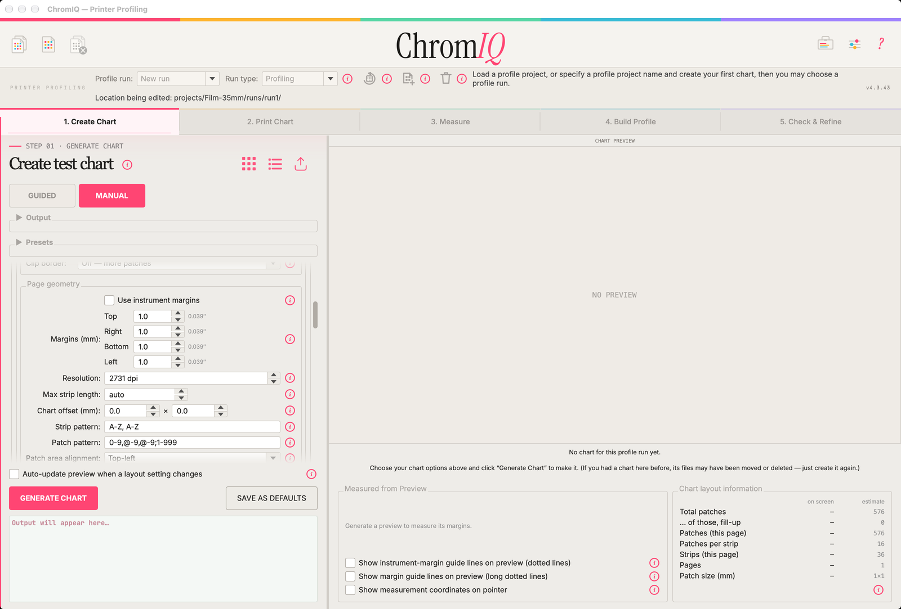

**Step 5.** Open **"Expert Options"** (click its title) and, under "Patches &
spacers", set **"Spacers:"** to **"None"**.

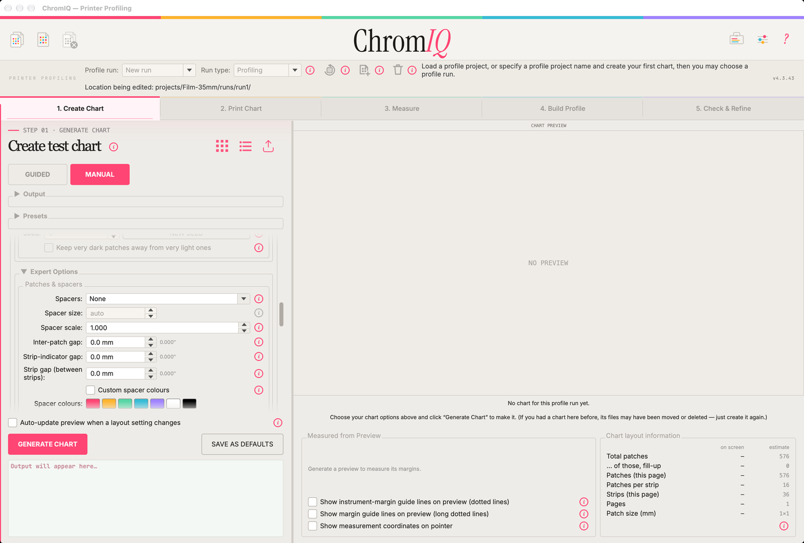

**Step 6.** A little further down, under "Output":

- "Bit depth:" **"8-bit"**
- "Compression:" **"None"**
- "Resolution unit:" **"Pixels per inch"**

Further down again, under "Sheet text", leave "Custom text:" empty and make
sure **"Stamp layout summary along the bottom"** is unticked.

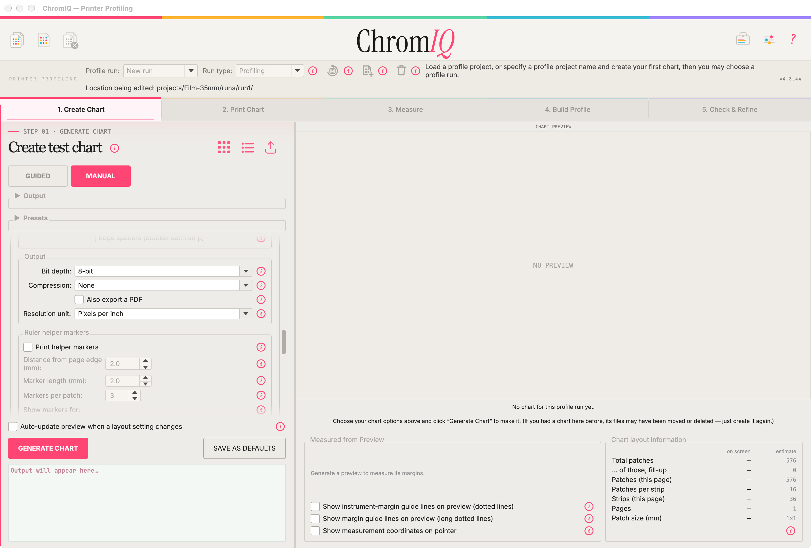

**Step 7.** Click **GENERATE CHART**. After a second or two the chart is in the
preview, and:

- the log under the button says
  "[ChromIQ layout engine] 576 patches (16×36), 1 page";
- "Chart layout information" says Total patches **576**, Patches per strip
  **16**, Strips (this page) **36**, Pages **1**, Patch size (mm) **1×1**;
- "Measured from Preview" says **"Margins: OK"**.

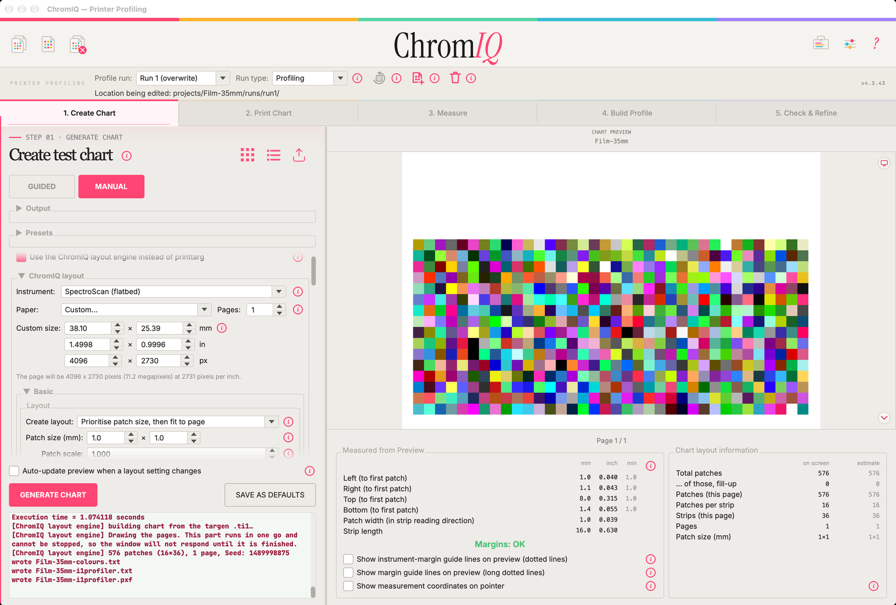

**Why there is a white band above the patches.** "Measured from Preview" shows
"Top (to first patch)" **8.0 mm**, although the top margin is 1.0 mm. The
SpectroScan layout keeps a fixed space at the top of every page, and no
setting in Create Chart makes it smaller. On a frame only 25.4 mm high this
costs about five rows of 1 mm patches, which is why the frame holds 576 and
not more. Left, right and bottom follow your margins (1.0, 1.1 and 1.4 mm).

**Where the file is.** The chart is saved in your project folder, which is
`ChromIQ/Film-35mm/runs/run1/` in your home folder unless you chose another
output folder in the preferences. The image is **`Film-35mm.tif`**. A chart
with more than one page has one file per page: `Film-35mm_01.tif`,
`Film-35mm_02.tif` and so on. The other files beside it (`.ti1`, `.ti2`,
`.channels.json`, `-colours.txt` and the i1Profiler files) belong to the
chart; keep them, ChromIQ needs the `.ti2` to read the measurement back.

**What is in the file.** We read the tags of the generated `Film-35mm.tif`:

| Tag | Value |
|---|---|
| ImageWidth x ImageLength | 4096 x 2730 pixels |
| SamplesPerPixel / BitsPerSample | 3 / 8, 8, 8 (RGB, 8 bit per channel) |
| PhotometricInterpretation | 2 (RGB) |
| XResolution / YResolution | 2731/1 and 2731/1 |
| ResolutionUnit | 2 (inch) |
| Compression | 1 (none) |
| Pages in the file | 1 |

So the file says exactly "4096 x 2730 pixels at 2731 pixels per inch", 8 bit
RGB, uncompressed.

**A small rough edge we know of.** If you also have the FD-9 beta switched
on, choosing the FD-9 as instrument and then going back can turn a size typed
in pixels into millimetres. And whenever you have changed instrument or paper,
please look at the pixel line once more before you click GENERATE CHART: it is
the quickest check that the page is still what your recorder needs.

---

## 5. The two larger frames

The steps are the same as in section 4; only the numbers change.

**8192 x 5460 pixels at 5461 ppi.** This is the same 35 mm frame (about
38.1 x 25.4 mm) at twice the resolution, so the same patches fit (see the table
in section 6). Set "Resolution:" to **5461** and type **8192** x **5460** in the
px row. The generated file reads 8192 x 5460 pixels, 5461/1 pixels per inch
(ResolutionUnit 2), 8 bit RGB, Compression 1 (none).

**18796 x 15748 pixels at 2032 ppi (9.25 x 7.75 inches).** Set "Resolution:"
to **2032** and type **18796** x **15748** in the px row. The rows then show
234.95 x 196.85 mm and 9.2500 x 7.7500 in, and the line says "The page will be
18796 x 15748 pixels (296.0 megapixels) at 2032 pixels per inch."

The picture shows this frame with **5 x 5 mm** patches and otherwise the same
settings as in section 4: 1702 patches (46 strips of 37), one page,
"Margins: OK". The generated file reads 18796 x 15748 pixels, 2032/1 pixels
per inch (ResolutionUnit 2), 8 bit RGB, Compression 1 (none). Here the chart
took about four seconds to make, and the uncompressed file is about 888 MB.

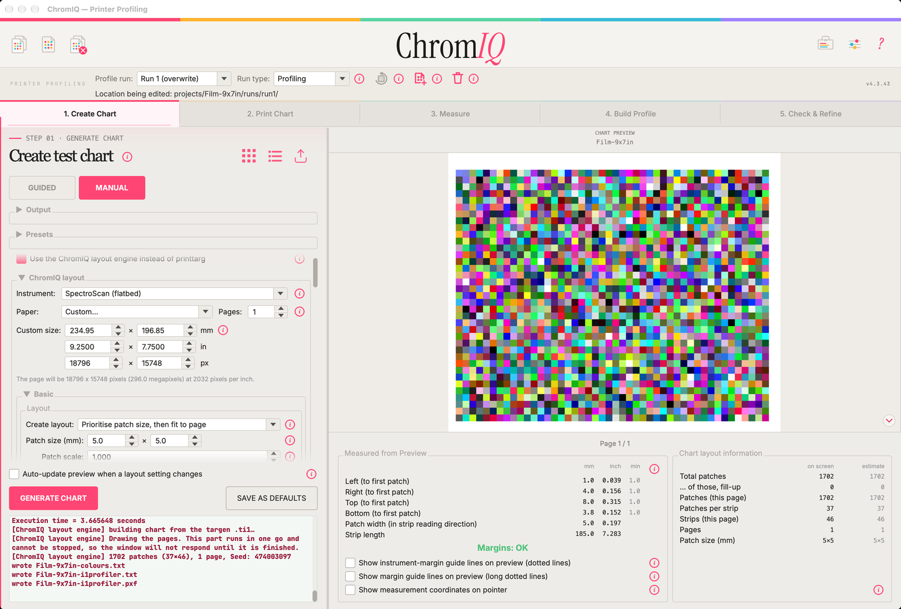

On the large frame there is room for the strip letters and row numbers if you
want them (the SpectroScan layout prints them when "Show strip indicators" and
"Show row indicators" are ticked). With 1 mm margins ChromIQ then widens the
left margin to fit the row numbers and says so in yellow under the preview;
the patch counts are in the table below.

---

## 6. How many patches fit on one frame

Measured in ChromIQ 4.3.43 with the settings of section 4 (SpectroScan, all
margins 1 mm, instrument margins off, no labels, no clip border, no spacers,
no stamp), one GENERATE CHART per line. Every one of them came out with
"Margins: OK". "Strips" are the columns, "per strip" the rows.

**35 mm frame: 4096 x 2730 at 2731 ppi, and 8192 x 5460 at 5461 ppi** (both
give the same numbers):

| Patch size | Patches per frame | Strips x per strip |
|---|---|---|
| 1.0 x 1.0 mm | 576 | 36 x 16 |
| 1.5 x 1.5 mm | 240 | 24 x 10 |
| 2.0 x 2.0 mm | 144 | 18 x 8 |
| 3.0 x 3.0 mm | 60 | 12 x 5 |

**9.25 x 7.75 inch frame: 18796 x 15748 at 2032 ppi**, no labels:

| Patch size | Patches per frame | Strips x per strip |
|---|---|---|
| 3 x 3 mm | 4774 | 77 x 62 |
| 4 x 4 mm | 2668 | 58 x 46 |
| 5 x 5 mm | 1702 | 46 x 37 |
| 6 x 6 mm | 1178 | 38 x 31 |

The same frame with "Show strip indicators" and "Show row indicators" ticked
(the left margin is widened for the row numbers, with a yellow note):

| Patch size | Patches per frame | Strips x per strip |
|---|---|---|
| 4 x 4 mm | 2520 | 56 x 45 |
| 5 x 5 mm | 1584 | 44 x 36 |
| 6 x 6 mm | 1110 | 37 x 30 |

**Which patch size is right depends on your instrument, and you know it better
than we do.** The patch has to be larger than the measuring spot, with room
for the table's positioning. You mentioned the 0.5 mm aperture for the small
frames and the 3 mm aperture for the large ones; how much margin around the
spot your Spectro 100xy needs is something only a test on the real film can
tell. The tables let you pick.

If one frame holds fewer patches than you want, a chart can have several
frames: each page of the chart is one frame of exactly the same pixel size
(section 7 shows a two-frame chart).

---

## 7. Choosing your own colours with the patch set generator

By default ChromIQ fills the frame with a well-spread set of colours. If you
want to decide which colours go on the frames, for example a long grey ramp
and colours close to neutral, use the patch set generator. The page layout
stays exactly as you set it in Create Chart.

First make the chart once as in section 4, so that the project has a chart.
Note the number of patches one frame holds (576 for 1 mm patches on the 35 mm
frame).

1. Click the **Tools** button at the top right of the window (the toolbox
   icon, left of the preferences sliders).
2. Under "CHARTS & PATCH SETS" choose **"Edit / create chart patch set"**.

   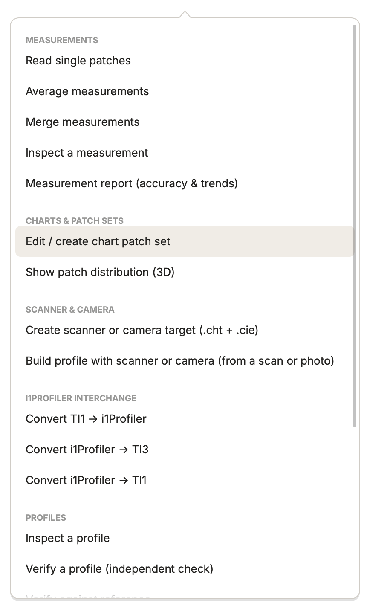

3. The editor opens with your chart. Its top line names the page as it really
   is: "laid out for the SpectroScan on 4096 x 2730 pixels at 2731 pixels per
   inch". Click **"NEW PATCH SET…"**.
4. In the window "New patch set", choose **"Generate colour sets"**.
5. Untick the groups you do not want. Several are ticked when the window opens
   (here "Skin tones (Fitzpatrick)", "Oceans (blues)", "Foliage (greens)",
   "Sunrises (warm)" and "Flamingos (pinks)"), so look down the whole list.
6. An example for two frames of 576 patches:
   - "3D RGB cube", "per axis:" 6 (216 patches)
   - "Gamut-corner emphasis", "edge:" 2 (48 patches)
   - "Neutral grey ramp", "steps:" 32 (32 patches): the long grey ramp
   - "Near-neutral greys", "steps:" 11, "rings:" 2, "offset:" 4 (198 patches):
     small tints in rings around the grey axis, which help to find the true
     neutral of the film
   - "Pure white & black", "each:" 2
   - "Fill remaining gaps", "fill to:" **1152** patches. This is the size of the
     finished set: **patches per frame times the number of frames**, here
     576 x 2. It adds 656 patches spread evenly through the colour space, so
     that both frames are exactly full.
   - "Ensure unique colours" ticked.

   The line at the bottom must say **"Total: 1152 patches"**.

   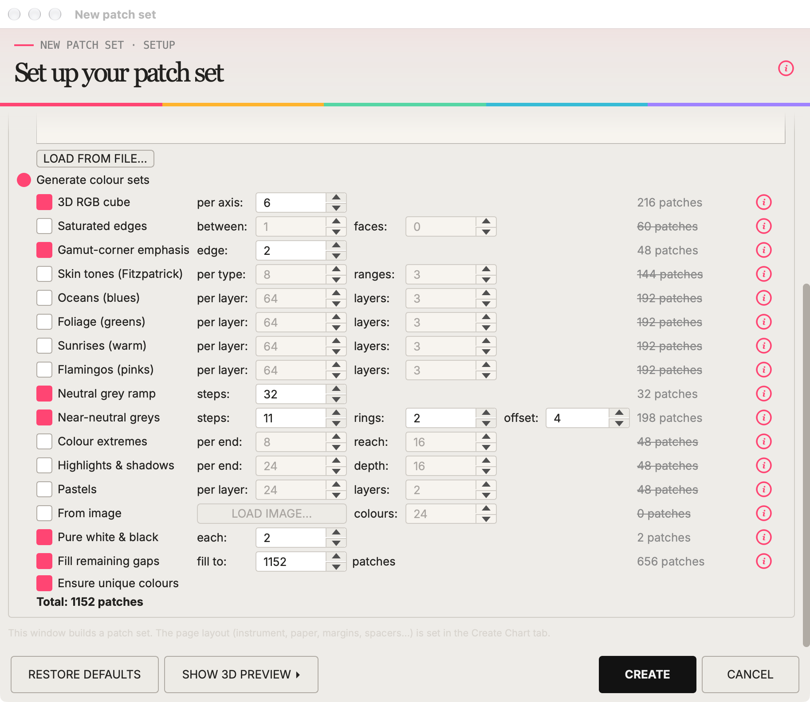

7. Click **CREATE**. The editor now says "New chart: 1152 patches".
8. Click **"APPLY / SAVE…"** and, in the window "Apply or save this patch set",
   **"OVERWRITE"**. This sends the set back to "1. Create Chart", which lays it
   out with your frame settings. You can then close the editor.

Back in Create Chart, the log says "[ChromIQ layout engine] 1152 patches
(16×36), 2 pages", the preview shows "Page 1 / 2", and the pixel line still
says "The page will be 4096 x 2730 pixels (11.2 megapixels) at 2731 pixels per
inch." **The page is still pixel-exact**: we read both files,
`Film-35mm_01.tif` and `Film-35mm_02.tif`, and each is 4096 x 2730 pixels at
2731/1 pixels per inch, 8 bit RGB, uncompressed. You do not need to change
"Pages:"; a set larger than one frame simply goes onto more frames.

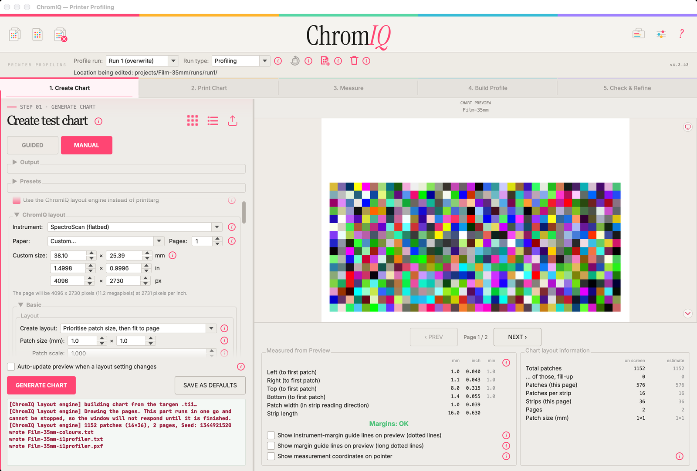

---

## 8. Measuring elsewhere and bringing the measurement back

ChromIQ measures through ArgyllCMS, and ArgyllCMS has no driver for Barbieri
instruments, so a chart for the Spectro 100xy is measured in Barbieri's own
software (Spectro32) and the measurement is brought back as a `.ti3` file. You
already have a converter that writes such a `.ti3` with the chart's own patch
names, and ChromIQ took it without complaint, so nothing changes there. Load it
with the load icon at the top right of **"4. Build Profile"** ("Load your
measurement data").

For film, open **MANUAL** in "4. Build Profile" and set **"Media Type (-Z t):"**
to **"Transparent"**; set "Media Polarity (-Z n):" to "Negative" if it is a
negative, and leave "Media Surface (-Z m):" as it is. These only mark the kind
of medium in the profile's header; they do not change how its colours are
worked out.

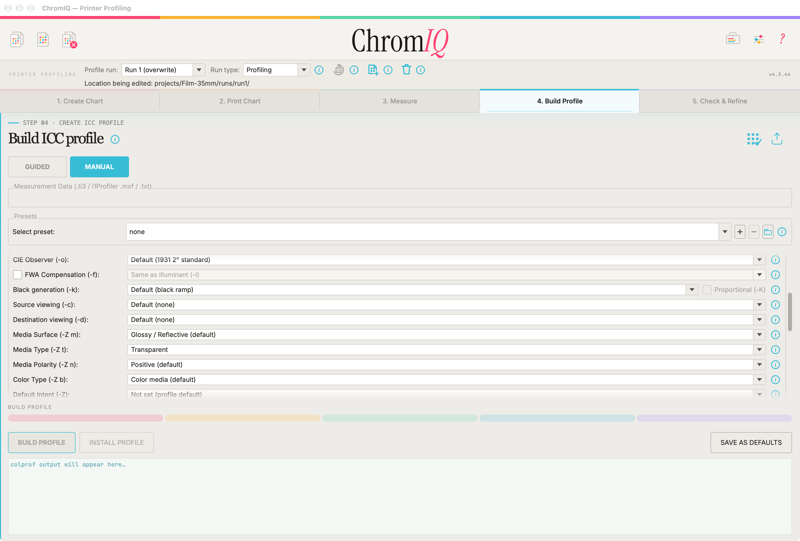

---

## 9. What we would like to hear from you

Nobody here has a film recorder, so your report is what tells us whether this
works. The most useful things are:

1. **Does the recorder take the file without scaling it?** Does it read
   4096 x 2730 at 2731 (or your other frame) as it should?
2. **A photo** of an imaged frame, if you can.
3. **Any message** ChromIQ or the recorder showed, as a screenshot or copied
   text.
4. Which patch size your Spectro 100xy read reliably on the film.

Please post it in [issue 215](https://github.com/itsab1989/ChromIQ/issues/215).
