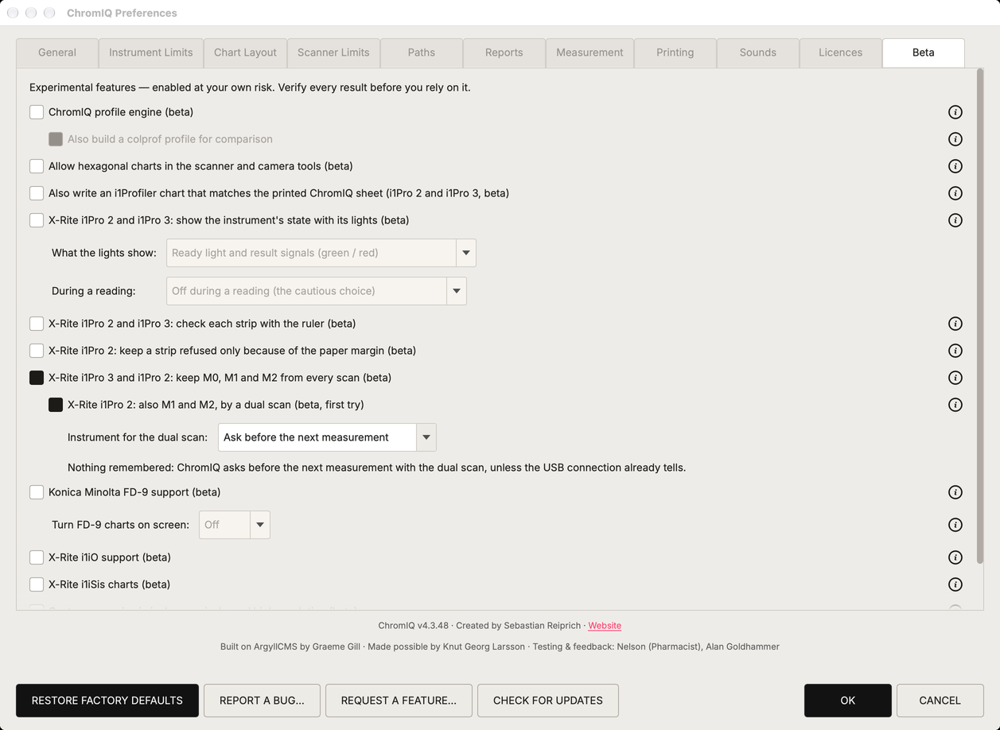
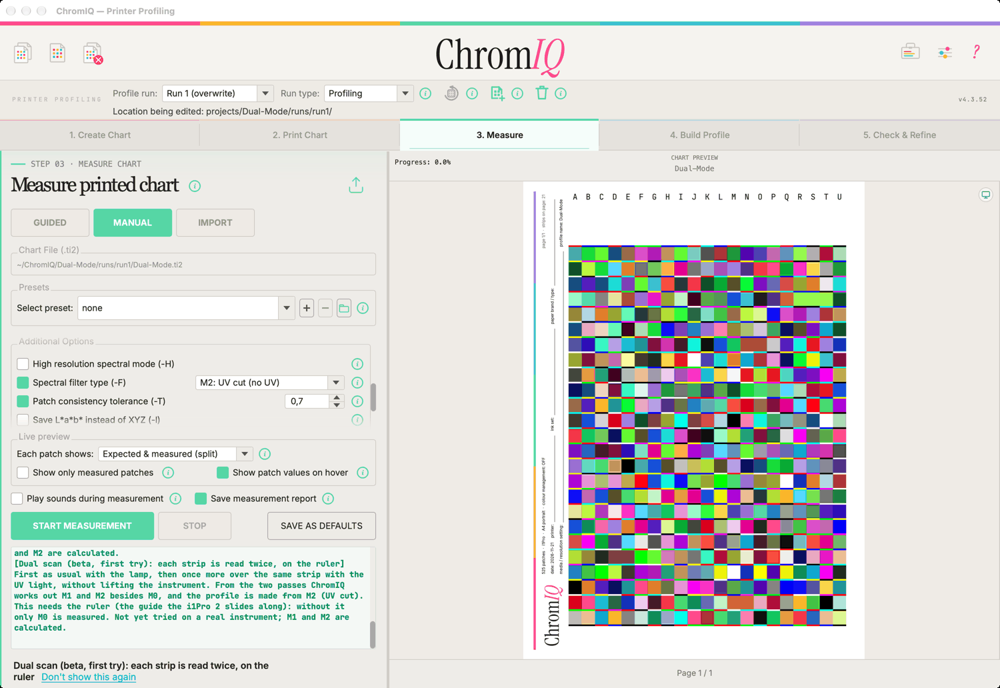
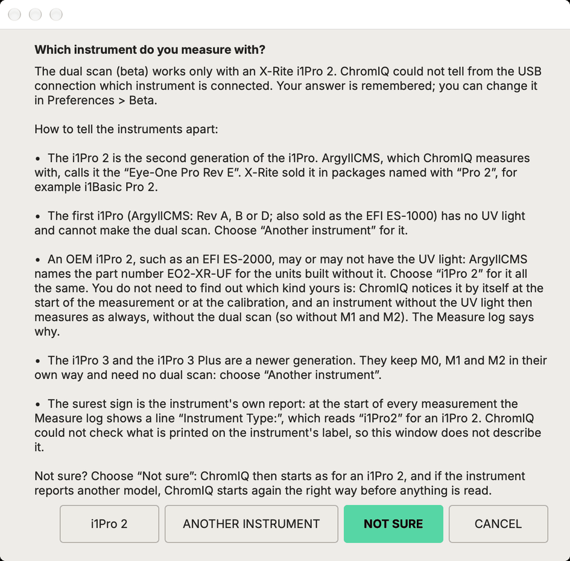
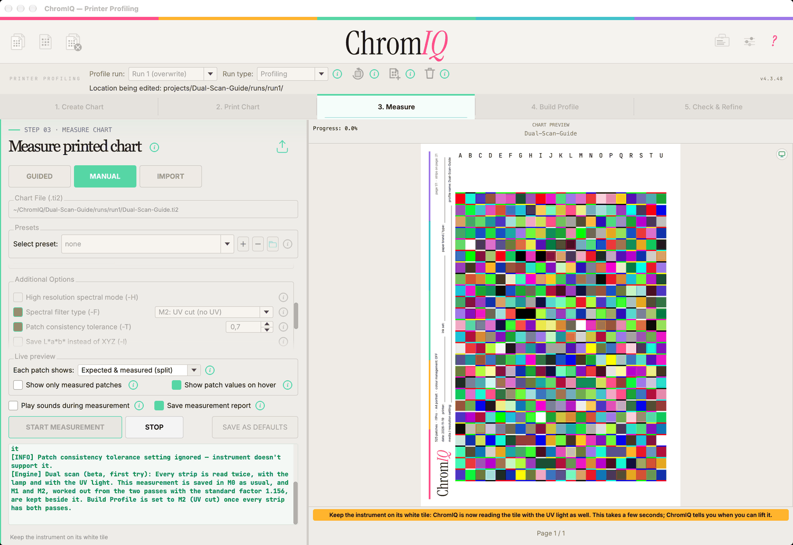
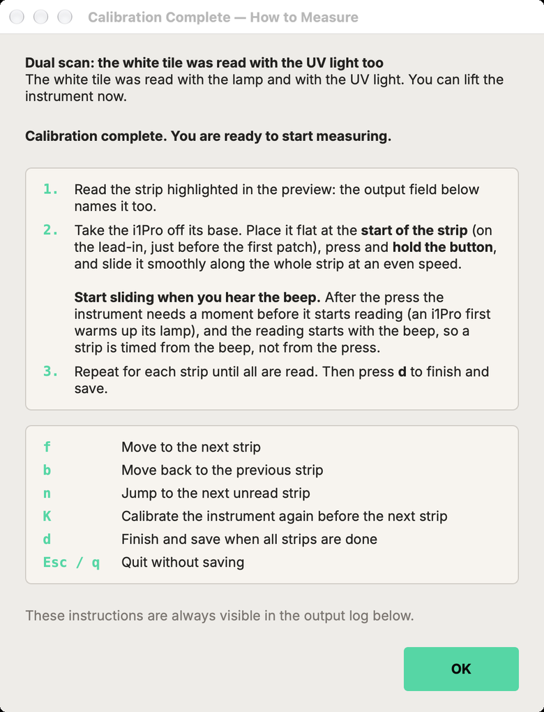
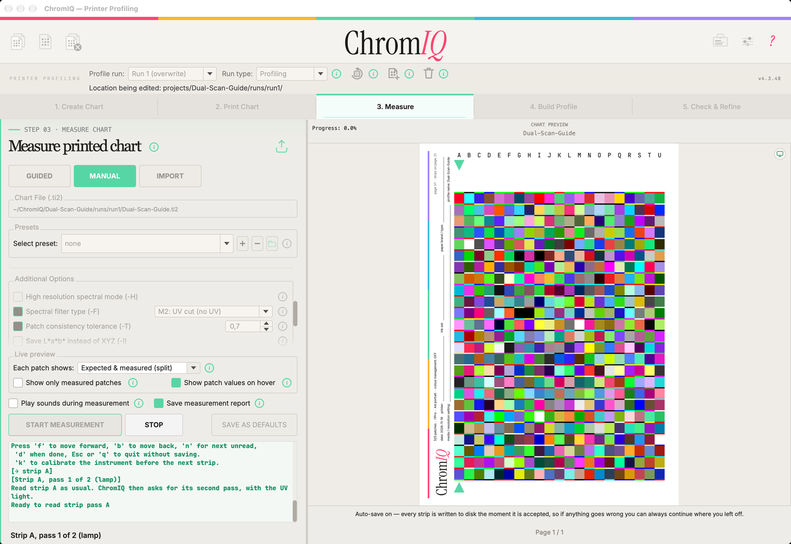
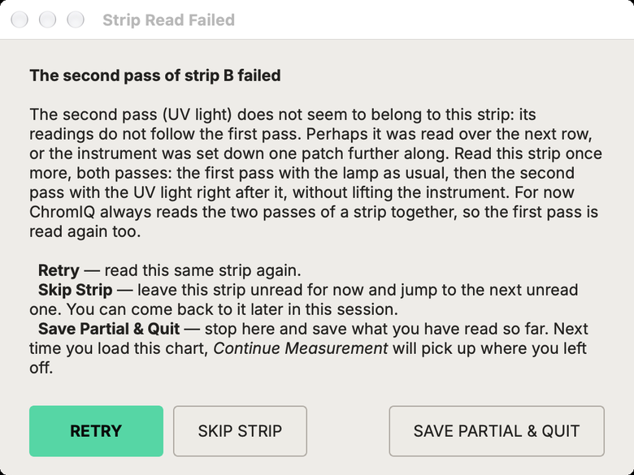
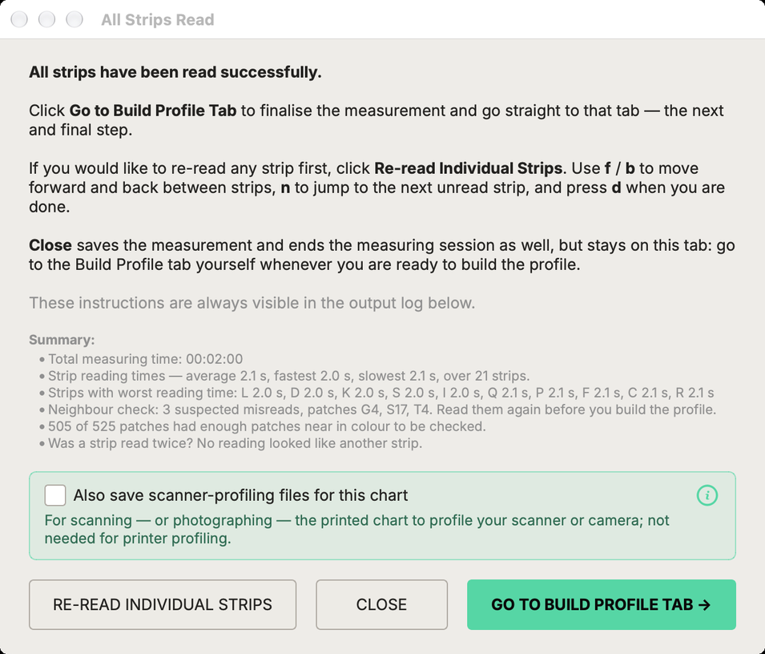
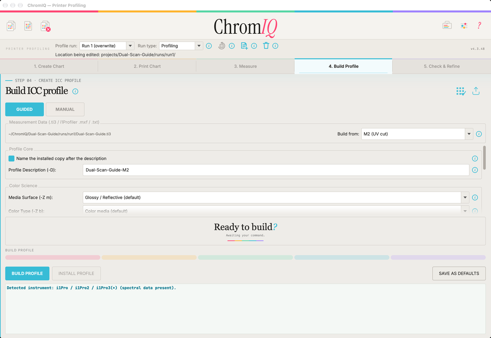
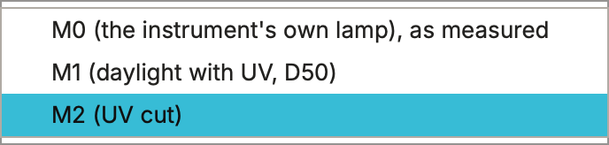

# M0, M1 and M2 from an X-Rite i1Pro 2: the dual scan, step by step

This guide shows how to measure a chart by hand with the **dual scan** of an X-Rite i1Pro 2,
what to look for at each step, and what to send us after a first try. The dual scan is new in
ChromIQ 4.3.48. It is a beta option and a first try: **a tester has made two real dual scans by
hand with an i1Pro 2; the pass with the lamp is sound, and M1 and M2 have not yet been checked
against a reference.** Please read [Honest limits](#honest-limits) before you rely on it.

> The pictures in this guide were made with the real ChromIQ app in a real window, but with a
> **simulated instrument**: the readings are invented, and so are the three "suspected misreads"
> in picture 9. The paths in the pictures were shortened to `~/ChromIQ/...`.

## What the dual scan is, and what it is for

M0, M1 and M2 are three ways of measuring the same colour. They differ only in how much
ultraviolet (UV) light reaches the paper:

* **M0** is what the instrument's own lamp gives. Until now this was all an i1Pro 2 gave ChromIQ.
* **M1** adds the amount of UV that daylight has (the ISO 13655 condition for D50).
* **M2** leaves the UV out altogether ("UV cut").

They matter for papers with optical brighteners, which glow blue under UV light. On such paper
the three conditions give noticeably different numbers, and a profile made from the condition
that matches how your prints will be viewed can be the better one.

An i1Pro 2 has a small UV light beside its lamp. X-Rite's own software uses it to read each strip
a second time. With the dual scan on, ChromIQ does the same: it reads every strip twice, first
as usual with the lamp, then once more over the same strip with the UV light, and works out M1
and M2 from the two readings and the data X-Rite stored in your instrument at the factory.
ChromIQ does this itself: you do not need i1Profiler or a licence for any X-Rite software.

## What you need

* An **X-Rite i1Pro 2** (ArgyllCMS calls it the "Eye-One Pro Rev E"), with its **white
  calibration tile** and its **position ruler** (the guide the instrument slides along when you
  read a strip). **The dual scan by hand needs the ruler**: ChromIQ matches the two passes patch
  by patch with the instrument's position readings. Without the ruler, ChromIQ measures M0 only.
* A chart made in **Create Chart** for the i1Pro (the "i1Pro" entry covers the i1Pro 2).

Which instruments cannot do it:

* The **first i1Pro** (ArgyllCMS: Rev A, B or D; also sold as the EFI ES-1000) has no UV light.
* Some **OEM i1Pro 2** units, such as an EFI ES-2000, were built without the UV light (ArgyllCMS
  names the part number EO2-XR-UF for them), and some units may lack the factory data the dual
  scan needs. You do not need to find out which kind yours is: choose "i1Pro 2" for it all the
  same. ChromIQ notices it by itself at the start of the measurement or at the calibration, and
  such an instrument then measures as always, without the dual scan (so without M1 and M2). The
  Measure log says why.
* The **i1Pro 3** and **i1Pro 3 Plus** need no dual scan: they keep M0, M1 and M2 in their own
  way (the option above the dual-scan switch is for them).

Not available with the dual scan: **"High resolution spectral mode (-H)"** (the instrument's
factory data for M1 and M2 is given only at 10 nm steps). Switch it off before a dual-scan
measurement: with it on, ChromIQ does not start the measurement and says why (since 4.3.49).

## 1. Switch it on

Open **Preferences > Beta** and switch on **"X-Rite i1Pro 3 and i1Pro 2: keep M0, M1 and M2 from
every scan (beta)"**, then the switch under it, **"X-Rite i1Pro 2: also M1 and M2, by a dual scan
(beta, first try)"**. A window first says what the option does and asks you to confirm it. The ⓘ
beside each switch explains it in more detail.

Beside the switch, in the same line, a list chooses **when the dual scan runs** (since 4.3.54):

* **"always"**: every strip is read twice, and M0, M1 and M2 are saved, whatever condition you
  choose in the Measure tab.
* **"only for M1 or M2"**: the condition you choose in the Measure tab decides (step 2). With M0
  chosen, each strip is read once, as without the dual scan, and only M0 is saved. With M1 or M2
  chosen, each strip is read twice, and M0, M1 and M2 are all saved. The cost: a chart measured
  with M0 chosen has no M1 or M2, and you cannot add them later without measuring the chart
  again as a new measurement.

When you switch the dual scan on, the list starts at "only for M1 or M2". If the dual scan was
already on before ChromIQ 4.3.54, "always" is kept for you, so nothing changes until you choose.

Under the switch, **"Instrument for the dual scan:"** shows what ChromIQ remembers about your
instrument: "Ask before the next measurement" (nothing remembered yet), "i1Pro 2", or "Another
instrument (not an i1Pro 2)". You can change it here at any time.

## 2. The Measure tab before START

Load your chart in the **Measure** tab as usual and switch to **MANUAL**: the row **"Spectral
filter type (-F)"** is under Additional Options there. With the dual scan on, it chooses
**which condition your profile is made from**: "M0: no filter (lamp as it is)", "M1: D50
daylight (with UV)" or "M2: UV cut (no UV)". With an i1Pro 2 it is not sent to the instrument
(an i1Pro 2 has no filter ArgyllCMS could switch); ChromIQ records your choice. With the row
switched off, the profile is made from M0. With **"only for M1 or M2"** (step 1), this row also
decides whether the dual scan runs: M0 = one pass per strip, M1 or M2 = two passes. GUIDED has no
such row: there the dual scan always runs, and the profile is made from M0 (Build Profile can
still build from M1 or M2).

**You measure the chart once**, not once for each condition: each strip is read twice, right
after each other, and all three conditions come from that one measurement.

The line under the log says what will happen. When the dual scan will run, it says **"Dual scan
(beta, first try): each strip is read twice, on the ruler"**, and the log explains it: first as
usual with the lamp, then once more over the same strip with the UV light, without lifting the
instrument. When it will not run, the line says why, for example **"Dual scan: not used, because
M0 is chosen"**, **"Dual scan: cannot run while “High resolution spectral mode (-H)” is on"**, or
**"Dual scan: not used, because the instrument is not an i1Pro 2"**. Hold the pointer over the
line for the whole note. Beside it, **"Don't show this again"** switches that note off for good
(only that kind: a note for another reason still shows). The app's log file still records the
reason at every start. Restore Factory Defaults brings the notes back.

Two things refuse the start, with a window that says what to change:

* **"Spectral filter type (-F)"** set to a choice an i1Pro 2 does not have (a polarising filter
  or D65).
* **"Skip initial calibration (-N)"** ticked: the dual scan needs a new calibration at the start of
  every measurement, because only then is the white tile read with the UV light too.

## 3. Which instrument?

The first time, if ChromIQ cannot tell from the USB connection which instrument is connected, it
asks **"Which instrument do you measure with?"** and explains how to tell the instruments apart.
Choose **i1Pro 2**. Not sure? Choose **Not sure**: ChromIQ then starts as for an i1Pro 2. Your
answer is remembered (see step 1).

At the start of every measurement the instrument reports itself (the Measure log shows a line
"Instrument Type:", which reads "i1Pro2" for an i1Pro 2), and that report always wins: if it is
not what ChromIQ assumed, ChromIQ starts the measurement again the right way before anything is
read, and says so.

## 4. The calibration: keep the instrument on its tile

Put the instrument on its white tile and start the calibration as usual. With the dual scan the
calibration also reads the tile with the UV light, which takes a few seconds more. **Keep the
instrument on the tile** until ChromIQ says you can lift it: the amber line under the chart says
"Keep the instrument on its white tile ...".

When the window **Calibration Complete** says that the white tile was read with the UV light too,
you can lift the instrument.

If the UV reading of the tile did not succeed, the window says that M1 and M2 cannot be worked
out from this calibration. To keep M1 and M2, calibrate again (press K or the Calibrate button)
before the next strip. If you read a strip without calibrating again, ChromIQ reads it once,
does not keep it, and asks you once more to calibrate (**"Calibrate again to keep M1 and M2"**
in the Strip Read Failed window). Press **Retry** in that window, then calibrate before you
read the strip again. ChromIQ asks only once for each calibration: the next strip you read
without calibrating (the same one after Retry, or another one after Skip Strip) is kept with M0
only, and M1 and M2 end for the rest of the measurement. The line under the log says so before
you read it (**"Strip A: calibrate now, or M1 and M2 end"**).

## 5. Each strip twice: pass 1 with the lamp, pass 2 with the UV light

Put the instrument on the ruler at the strip the preview marks (the green arrows above and below
the strip). The line under the log tells you which pass is due.

**Pass 1 of 2 (lamp).** Read the strip as usual.

**Pass 2 of 2 (UV light).** Read the **same strip** once more, **without lifting the instrument
off the ruler**: from the white paper before the first patch to the white paper after the last,
at an even speed. **Either direction is fine**: the ruler tells ChromIQ which way you went. This
time the instrument reads with
its UV light.

What to look for:

* The line under the log names the strip and the pass. Read pass 2 only when it says
  "pass 2 of 2 (UV light)".
* The green arrows in the preview mark the strip that is due. Both passes are of that strip.
* During pass 2 the instrument's UV light should come on. Please tell us whether you saw it.
* While pass 2 is due, ChromIQ does not move to another strip or patch: a click on the preview,
  an arrow key or "I read strip B" is held, and the line under the log says **"Strip A: read its
  second pass first"**. The same for a click while pass 1 is being read: it is held, and the line
  says so as soon as pass 2 is due. Read pass 2, then choose again. A calibration you ask for then starts
  after pass 2. Stop still ends the measurement at any time.

ChromIQ checks that the second pass really belongs to the same strip: it matches the two passes
patch by patch with the ruler's positions and compares their readings. A second pass over the
wrong strip, one too short, too fast, too slow, one that jumped part of the way, one that does
not line up with the first, or one that brought back almost no light, is **refused**.

## 6. A refused second pass: both passes are read again

When a pass is refused, the window **Strip Read Failed** says why and what to do. For now
ChromIQ always reads the two passes of a strip together, so **both passes are read again**:
press **Retry** and read the strip with the lamp, then with the UV light. **Skip Strip** leaves
the strip for later in this session, **Save Partial & Quit** keeps what was read so far.

### When M1 and M2 stop for the rest of a sitting

In a few cases M1 and M2 cannot go on for the rest of the sitting. The Measure tab then says
**"Dual scan: M1 and M2 stop for the rest of this sitting"** with the reason, that the strips
already read with both passes keep their M1 and M2, and that from here on ChromIQ reads M0 as
always, one pass per strip: carry on measuring. The cases are:

* the ruler cannot be used for the rest of the measurement (it gave no usable positions, or a
  second pass was left unread with Esc);
* the instrument is not an i1Pro 2, or does not offer what the dual scan needs;
* a strip was read twice after a calibration that could not give M1 and M2, without calibrating
  again in between (the first time, ChromIQ does not keep the strip and asks you to calibrate);
* a value was typed in by hand;
* the files for M1 and M2 could not be saved, or something unexpected happened (the app's log
  file has the details).

A strip read after that has M0 only. **Nothing already read is lost**: the strips that have both
passes keep their M1 and M2 (since 4.3.49; before, they were thrown away at the end of the
sitting). The same holds when you read a strip again later without its second pass, for
example from Check & Refine's list: that strip has M0 only from then on (its old M1 and M2 go
with its old reading), and every other strip keeps its own.

Only when the files cannot be saved, or the computer runs out of memory, do M1 and M2 end for
good; the Measure tab then still says **"Dual scan: M1 and M2 stop for this measurement"**.

### Completing the strips that have M0 only

To give those strips their M1 and M2, stop as usual (**Save Partial & Quit** if strips are
still missing), then tick **"Refine / resume existing measurement (-r)"** and press **Continue
Measurement**, with the dual scan still switched on. Before you press it, the line under the log
names the strips (**"Dual scan: Continue Measurement also reads strips B, C again"**; without
the tick it says how to do it: **"Dual scan: M1 and M2 are missing from strips B, C"**). ChromIQ asks for a
calibration first, as at every start, reads the strips not read yet with both passes, and takes
you to each strip that has M0 only, as the refinement guide does, to read it again with both
passes. When every strip has both passes, Build Profile offers M1 and M2 again. Until then,
Build Profile offers M0 only and says which strips are missing their M1 and M2.

## 7. The end of the measurement and Build Profile

When every strip has both passes, **All Strips Read** appears as after any measurement.

The measurement is saved in M0 as usual, with M1 and M2 beside it. **Build Profile** then starts
with **"Build from:"** set to the condition you chose in the filter row of the Measure tab (here
M2), once every strip has both passes. The profile description gets the condition's name.

To build from another condition, open **"Build from:"** and choose it. Your choice stands.

### Where the files are

All of it stays in the run's folder (`~/ChromIQ/<your project>/runs/runN/`):

* `<project>.ti3`: the measurement, in M0, as always.
* `conditions/<number>-M1.ti3` and `conditions/<number>-M2.ti3`: the same patches in M1 and M2.
  The number is made from the measurement's readings, so the files stay paired with them.
* `conditions/<number>-M1.partial.ti3` and `-M2.partial.ti3`, instead, while some strips have
  M0 only: the M1 and M2 of the strips that have them. Build Profile does not use these files;
  Continue Measurement takes them up again. ChromIQ 4.3.48 and earlier ignore them.
* `dual_scan/<project>.passes.json`: ChromIQ's record of both passes of every strip and of the
  calibration's UV reading. It holds no serial number.

## Honest limits

* **The dual scan has been tried on a real instrument only twice.** A tester made two real dual
  scans by hand with an i1Pro 2: the pass with the lamp is sound, and M1 and M2 have not
  yet been checked against a reference. Nothing of it has run on a real table yet. It was built from USB
  recordings of X-Rite's i1Profiler, made with two i1Pro 2 instruments, and checked against those
  recordings and with a simulated instrument. Everything ChromIQ sends to the instrument for it is
  in the forms seen in those recordings, and nothing is written into the instrument. The first
  real runs may still stop early, or be refused where they should not be. If that happens,
  ChromIQ says why.
* **How close M1 and M2 come to X-Rite's own values.** On the recorded readings, ChromIQ's M1 and
  M2 agree with i1Profiler's values to a few hundredths of a ΔE00 on average (about 0.05 to 0.08)
  when the instrument's own factor is known. That factor differs from instrument to instrument,
  and ChromIQ uses a **standard factor** (1.156) for every i1Pro 2. With it, M2 was off by about
  0.2 ΔE00 on average (up to about 0.5 on single patches) on strongly brightened paper for one of
  the two instruments, and by less for the other; M1 by less. Papers without optical brightener
  should not be affected, but that has not been measured yet.
* By hand, the dual scan needs the ruler; if one pass of a strip fails, both passes are read
  again; strips read with M0 only are completed by Continue Measurement, after a new
  calibration, by reading them again with both passes (a strip's second pass cannot be read on
  its own).
* A measurement that ChromIQ 4.3.48 or earlier continued after M1 and M2 had ended was saved
  without its dual-scan record; it continues as M0 only.
* The new texts are shown as proposed texts and may still be reworded.

## What would help us

After a first try, whether it worked or not, please send us on
[GitHub](https://github.com/itsab1989/ChromIQ/issues):

* from the run's folder: the **`conditions/`** and **`dual_scan/`** folders and the measurement
  (`<project>.ti3`);
* the text of the **Measure log** (select it in the Measure tab and copy it);
* the app's **log file** (Help window, "Show the log file", left of Close): it says at every start
  whether the dual scan ran, and why not;
* a **USB recording** of the run, if you use a recording tool for that.

And please tell us:

* whether the **UV light came on during pass 2** (a faint violet glow under the instrument);
* whether any pass was **refused**, and with which message;
* whether M1 and M2 **stopped** for the measurement, and what the Measure tab said;
* which paper you measured, and whether it has optical brighteners.
